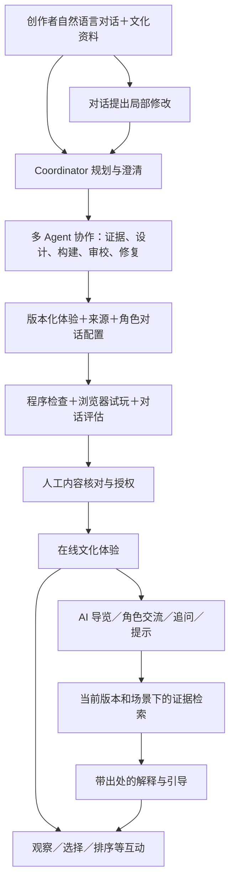
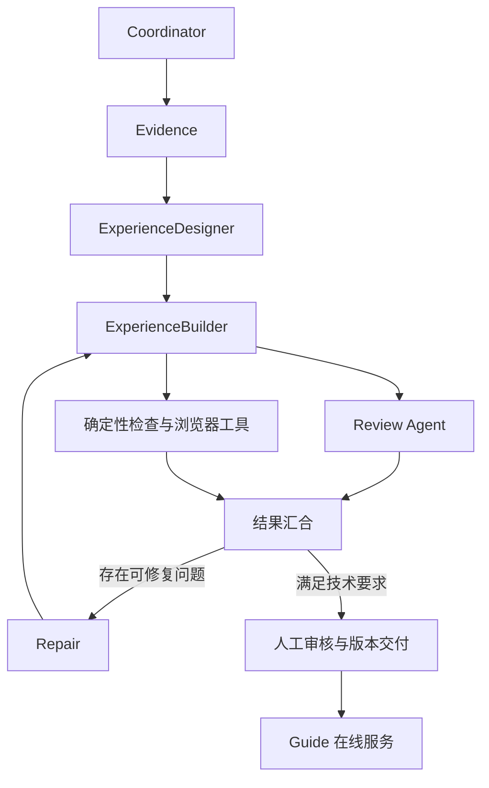
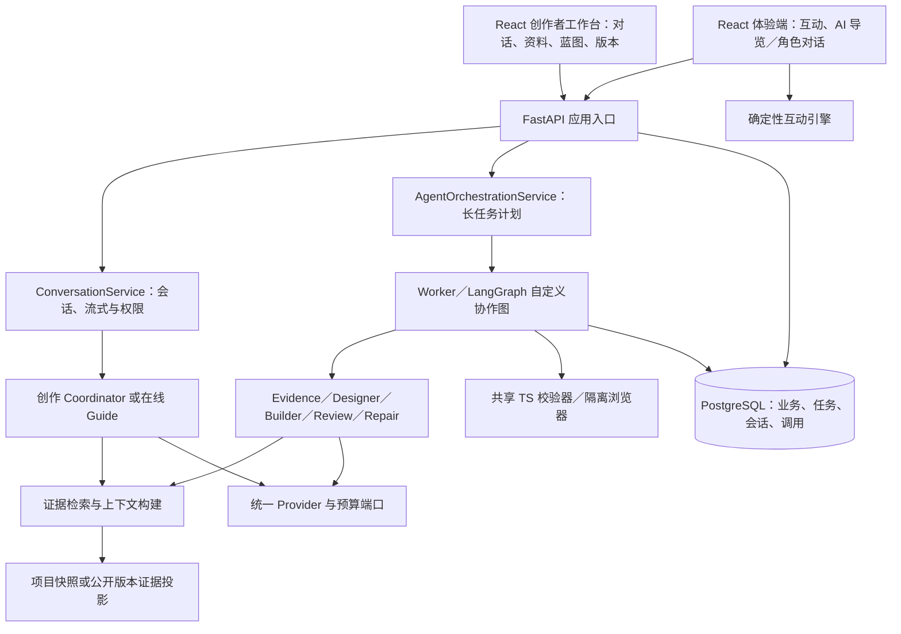
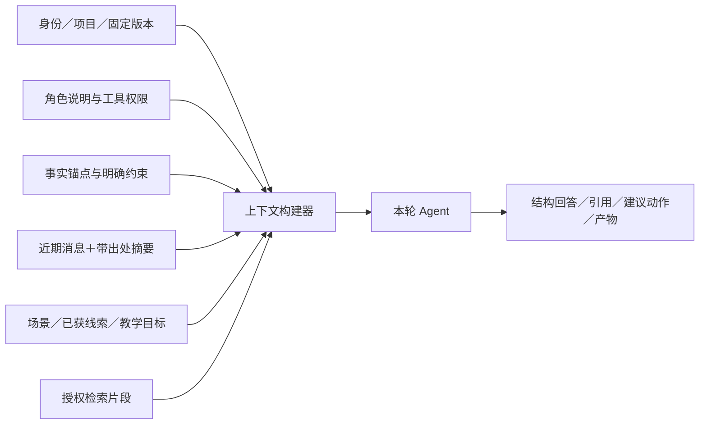
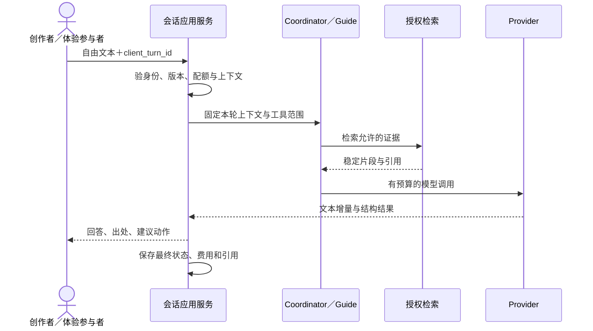
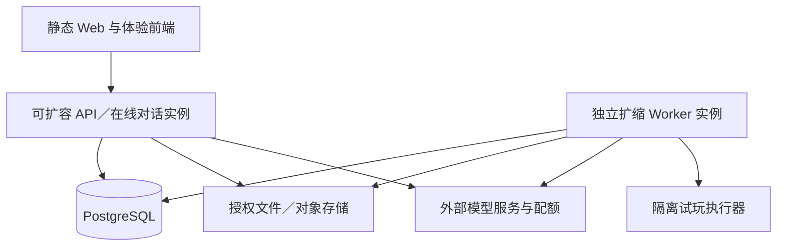
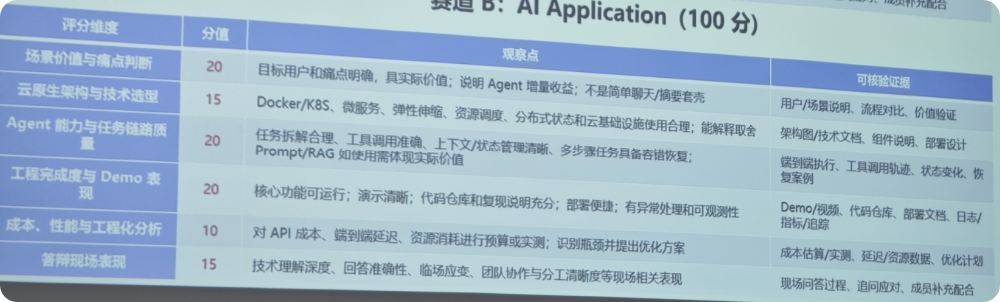

# 叙境 V2：多 Agent 协作与 AI 对话架构

> 2026-10-31 · 方向修正版  
> 当前总入口。本版按用户本轮明确要求，将多 Agent 与双端 AI 对话列入核心范围。旧版保留为历史，不再用其中的范围收缩指导开发。以下新增能力均为设计，尚未实现。

## 1. 本次纠正什么

上一版主动把实现收敛为串行阶段、固定互动组件、首版不做 AI 对话，没有先确认这个取舍。这导致方案向“互动配置执行器”偏移，Agent 协作和对话价值没有成为主线。这个收缩在本版撤销。

叙境的定位是：**面向文化内容与研学创作者，以多 Agent 协作理解资料、规划和生成文化体验；创作者通过 AI 对话持续共创，参与者通过有依据的 AI 导览或角色交流探索知识。**

面向用户统一称“创作者、内容审核者、体验参与者（学生／游客）”。三类结构化互动仍可保留，但不再代表产品全部能力。DreamForge 只提供规格驱动、验证和版本方法的参考，叙境的核心实体仍是文化资料、证据、教学目标、体验与对话，不转向通用游戏生成。

| 上一版偏差 | 当前要求 |
|---|---|
| “串行职责即可，不强制多 Agent” | 多 Agent 有真实计划、上下文、工具、交接、恢复及轨迹 |
| “参与者默认不调用模型” | 在线体验具有真实 AI 导览／角色对话 |
| 首版排除 AI 对话 | 创作者共创对话与体验端对话均进入核心范围 |
| 排序小样承担大量说明 | 小样只验证视觉，不能代表完整业务 |
| 静态包被表述成完整体验 | 在线完整版与离线资料版分开说明能力 |

决策依据：[ADR-0010](adr/0010-multi-agent-and-conversation.md)。

## 2. 产品主线与两类对话

**图 1｜完整主线。** AI 共创和体验对话是入口与运行能力，固定组件承担可控交互，二者共同构成文化体验。

| 对话端 | 使用者可以说什么 | 系统实际动作 |
|---|---|---|
| 创作共创 | “给五年级使用，五分钟，保留出处，先给两个体验思路。” | 澄清简报、检索材料、多 Agent 规划、展示蓝图 |
| 创作修改 | “第二个场景文字太多，改成和工坊师傅问答，但不要新增史实。” | 分析影响、生成新候选与对话设定、复测、重新审核 |
| 体验导览 | “为什么这一步必须在后面？这个说法出自哪里？” | 根据当前场景与已发布资料回答，给可点击出处 |
| 角色交流 | “如果我还没找到工具，师傅会怎么提醒我？” | 在明确改编角色设定下提供提示，保留事实边界与线索状态 |

体验端允许自然语言输入和连续追问，不退化为只有预设 FAQ。资料不足时说明缺口，角色对白可以创作，但不能伪装成历史原话。

## 3. 七种 Agent 的协作方案

| Agent | 输入与职责 | 输出／工具边界 |
|---|---|---|
| Coordinator | 创作者意图、约束、当前项目；规划、澄清和调度 | 有依赖的计划、子任务、结果汇总；经应用服务提交 |
| Evidence | 授权快照；提取事实、限定语、检索证据、列缺口 | Claim/EvidenceBundle；只读本项目材料 |
| ExperienceDesigner | 简报、事实和教学目标；设计场景、交互、对话角色 | Blueprint/DialoguePlan；不编造文化事实 |
| ExperienceBuilder | 冻结蓝图、组件和契约；构建体验与对话配置 | ExperienceSpec/DialogueProfile 候选；无任意脚本 |
| Review | 候选、证据、目标；检查表述、来源和目标覆盖 | 问题清单与建议；不能代替人工批准 |
| Repair | 检查反例、问题、允许路径；提出局部修订 | 新候选补丁／影响；不能删目标或改测试器 |
| Guide | 在线会话、角色、场景、线索与公开证据 | 回答、引用、提示和导航建议；只读发布版本 |

**图 2｜Agent 图。** 依赖阶段顺序执行；生成候选后审校和程序检查可并行。修复受轮数/调用/时间预算约束。Guide 不在每次用户追问时重新启动整条生成链。

多 Agent 的最低成立条件：独立 agent_id/task_id、角色配置版本、输入输出契约、上下文范围、工具白名单、状态与费用记录。可共用同一模型供应商，但必须发生真实委派与产物交接，不能只给普通函数贴上 Agent 名称。

## 4. 运行架构与 RAG

**图 3｜生成与在线对话分流。** API 对话用例异步调用服务端 Provider，不能让一个短问题排在长时间生成任务之后。模型凭据由服务端适配器管理，浏览器与静态包均无密钥。

RAG 有两类价值：生成时为事实/蓝图/审校提供材料证据；运行时为 Guide 提供版本、角色、当前场景与线索范围内的证据。初版可用段落检索，若召回评估不足再增加 pgvector/混合检索；不能把“使用向量库”本身当验收成果。

## 5. 上下文、记忆与 Agent 交接

**图 4｜上下文管理。** 事实锚点、权限和当前版本不能被对话摘要覆盖。摘要保留来源和不确定性，不能变成新的文化事实源。

交接采用 AgentTaskEnvelope/AgentResult，包含 project/run/task、输入引用/哈希、角色版本、工具权限、预算引用、fencing token、产物和问题。Agent 不共享任意可变全局会话，也不直接写数据库或稳定版本。业务事实在应用表/不可变产物，LangGraph checkpoint 仅保存执行状态。

## 6. AI 对话如何关联体验，又怎样验证

体验对话结合教学目标、场景和线索，回答后可建议“查看原文”“再观察器物”“尝试排序”，由前端展示受控动作。它能承载知识解释、连续追问、角色引导和提示，不仅是附加客服。

确定性引擎仍负责结构化动作、完成条件与状态。模型不能凭一句“答对了”直接把任务标为完成。若未来引入开放语义对话考核，需要独立评价协议和人工/规则回退，不能声称当前有限状态检查已证明所有自然语言对话正确。

对话评估至少包含：正确出处、无依据时说明、角色与场景一致、追问保持限定语、提示不过度泄题、越权/提示注入限制、长会话压缩、断线取消、延迟和每轮成本。技术可达性、对话质量、人工内容审核分别报告。

发布时的人工批准覆盖资料、关键事实与对话角色/提示策略，不表示未来每一轮模型回答已被人工审核。运行时仍需证据约束、未知回应、风险记录及必要时撤销服务；不能把“已审核版本”宣传为所有对话永远正确。

## 7. 数据、接口与恢复

沿用项目、来源、蓝图、版本、运行、报告和审核表，增加：

| 数据 | 内容 |
|---|---|
| agent_tasks / agent_handoffs | 专业子任务、委派、依赖、token、交接记录 |
| agent_artifacts / agent_reviews | 带 Schema/版本/来源的产物与模型审校问题 |
| conversation_sessions | creator/guide 类型、身份、项目、固定版本、角色、授权与到期 |
| conversation_turns / messages | client_turn_id 幂等、流式/终态、部分/完整回复、调用关联 |
| conversation_citations / context_snapshots | 片段引用、摘要版本、场景状态及上下文哈希 |

代表接口：创建项目对话、提交 turn、订阅 turn 事件、取消 turn、读取 Agent 子任务；分享令牌换取仅该版本的体验会话，再创建 Guide 对话。完整契约见 [API 补充](spec/api.md) 与 [F11](spec/features/F11-ai-conversation.md)。

**图 5｜在线对话链。** 一个会话同一时刻仅一个活动 turn；不同参与者不共用“项目唯一生成任务锁”。取消停止新调用，部分回复不当完整结果；事件/快照负责重连，不重复执行工具。

## 8. 成本、部署与离线边界

生成仍有全局 12 次模型调用／两轮修复上限，所有 Agent 共用预算。示例：规划、证据、设计、构建、审校约 5 次基础调用；两轮各一次修复和复审约 4 次，剩余次数受总额度约束，不保证每次都能修满两轮。

在线对话使用独立 ConversationBudget 和参与者/项目限流、轮数、输出长度与货币上限；额度缺失时不能无限开放。总组织/项目成本同时统计生成、失败、重试及对话。actual/estimated/unknown 分开，不把流式中断记零。

**图 6｜云原生部署目标。** 首版容器化 Web/API/Worker/PG/执行器；多 Agent 是逻辑角色，不对应七个微服务。Compose 用于可复现演示；若实际部署 K8s／弹性副本，补资源配置、分布式状态与扩缩实测，不能把 Compose 写成 K8s 已验收。

在线完整版包含实时 AI；离线资料版保留确定性互动、固定知识卡与来源，不具有实时 AI 对话。离线导出不带密钥、私有全文和聊天记录。在线分享撤销同时阻断资源与后续对话，已收到的回复或下载副本不能抹除。

## 9. 对照用户提供的赛道 B 评分

以下按截图整理，不代表已从赛事官网核验更多细则。截图要求证明 Agent 增量价值和任务链质量；它本身没有写“Agent 数量越多分越高”。本项目的多 Agent 同时来自用户明确要求。

| 评分维度 | 分值 | 本方案应提供的可核验证据 |
|---|---:|---|
| 场景价值与痛点判断 | 20 | 文化/研学用户流程、访谈、同资料制作对照、对话和协作带来的实际价值 |
| 云原生架构与技术选型 | 15 | 容器部署、API/Worker 分离、资源/状态与扩缩配置、实际取舍及部署证据 |
| Agent 能力与任务链路质量 | 20 | 自然语言目标→计划→真实委派/工具→上下文/产物→审校/恢复；RAG 真实支持答案 |
| 工程完成度与 Demo 表现 | 20 | 新材料现场创作、AI 连续追问、局部修改、日志/恢复和可复现仓库 |
| 成本、性能与工程化分析 | 10 | 每 Agent/每轮对话费用、首字/整轮延迟、失败与重试、并发和优化对照 |
| 答辩现场表现 | 15 | 清晰展示分工和证据，能解释选型、边界、成本与失败，不用虚构运行记录 |

## 10. 十一个功能模块与先后顺序

F01 项目工作台、F02 材料证据、F03 体验生成、F04 体验运行端、F05 检查修复、F06 任务费用、F07 版本修改、F08 审核交付、F09 安全运维仍保留；新增 [F10 多 Agent](spec/features/F10-multi-agent.md)、[F11 AI 对话](spec/features/F11-ai-conversation.md)。

实施先建立两条最小纵向链路，而不是长时间只做 UI 或排序引擎：

1. **创作链**：授权正文 → 创作对话 → Coordinator 计划 → Evidence/Designer/Builder/Review 真实协作 → 受控候选与出处。
2. **体验链**：固定候选 → 场景/角色 → Guide 自然语言问答与追问 → 有效出处 → 互动/提示关联。
3. 接入完整确定性引擎、程序/浏览器检查、有限修复、版本冲突和人工发布。
4. 完成恢复/取消/多参与者配额、容器部署、真实评估和答辩证据。

每条链都要有真实 Provider 记录；显式 mock 只用于开发，不能作为完成证据。具体任务以 [登记表](feature-registry.json)、[F10 SDD](sdd/features/F10-multi-agent.md)、[F11 SDD](sdd/features/F11-ai-conversation.md)、[修订路线](roadmap.md) 为准。

## 11. 当前状态与验收边界

当前真实存在：工程/设计文档、体验契约与样例、视觉 Token、独立 React/Motion 试作及局部 DOM 测试。**多 Agent 后端、真实 AI 对话、RAG 服务、正式引擎、发布与恢复仍待实现。** 本次修正文档没有冒充已经做出功能。

现有 ExperienceSpec 1.0 是三机制基线。DialogueProfile/ConversationBinding 作为版本化会话伴随配置进入候选/发布清单；首版不把开放语言判断直接加入引擎胜负条件。正式接入时锁定兼容协议，不在旧 Schema 中静默塞字段。

官方技术依据于本轮核对：[多 Agent 模式](https://docs.langchain.com/oss/python/langchain/multi-agent)、[持久化](https://docs.langchain.com/oss/python/langgraph/persistence)、[流式交互](https://docs.langchain.com/oss/python/langchain/streaming)。框架能力说明不代替本项目真实集成。
