# 叙境：整体业务架构与系统设计图

> **已被方向修正版替代。当前请阅读 [V2：多 Agent 协作与 AI 对话架构](architecture-and-design-v2.md)。** 本文保留上一轮设计与范围收缩的历史；其中“首版不做 AI 对话”“串行职责即可”等结论已撤销，不能作为现行开发依据。

> 审阅版 v1.0 · 2026-10-31  
> 项目：Story-to-Experience／叙境  
> 目的：集中说明项目要做什么、怎样实现、当前做到哪里，以及怎样避免后续开发偏离。  
> 核对基准：当前工作区、分支 main、HEAD `86bad69` 加尚未提交的文件。本文没有把设计图当作已运行系统。

## 1. 先确认方向：最终要交付什么

**叙境是面向文化教育创作者的互动体验生成系统。创作者提供有来源的材料，系统把其中的知识转成可探索、可试玩、可修改的轻量 H5 体验，并提供出处、检查记录和版本交付。**

项目的中心是“文化知识怎样进入玩家行动”。UI、Agent、检索和自动化测试服务于这条主线。

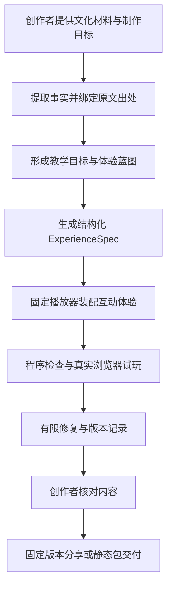

**图 1｜业务主线。** 这是目标流程，目前尚未贯通。成功交付应同时有：可操作体验、有效出处、技术检查结果、内容审核及版本清单。

### 1.1 使用者与交付物

| 使用者 | 做什么 | 获得什么 |
|---|---|---|
| 研学／文化内容创作者 | 上传材料，设定受众、时长与目标，修改体验 | 首个可玩版本、出处、修改差异、测试记录 |
| 内容审核者 | 核对关键陈述、答案、改编与材料使用权 | 按事实和任务组织的审核入口 |
| 学生／游客 | 观察、选择、排序、查看解释和复盘 | 一次约 3—5 分钟的文化探索 |

首版创作者和审核者可以是同一人，审核动作仍需独立记录。学生端默认不调用模型，也不收集姓名、联系方式和开放聊天内容。

### 1.2 范围与防偏离清单

| 首版要完成 | 首版暂不做 |
|---|---|
| 正文、文本 PDF、授权图片输入 | OCR、音视频理解、联网补充事实 |
| 事实、出处、目标与蓝图 | 跨机构知识库、自动权威认证 |
| 热点、分支选择、排序 | 任意游戏生成、实时物理、自由 NPC 对话 |
| 固定组件读取 ExperienceSpec | 模型自由生成并执行 JS／HTML／插件 |
| 自动检查、浏览器试玩、有限修复 | 开放世界自主试玩、自动证明趣味性或教育收益 |
| 局部修改、不可变版本、审核交付 | 多人实时协作、支付、复杂组织审批 |

以下现象意味着方向偏移：只剩漂亮页面而没有资料到体验的链路；把预置故事称为真实生成；把普通问答聊天替代互动体验；让模型直接改运行时；用“自动自审通过”替代实际测试或人工内容核对。

依据：[产品基线](product.md)、[方案依据](basis-and-changes.md)。本文保留原方案的文化教育定位和有限机制路线。

## 2. 当前实现与目标系统必须分开看

### 2.1 当前真实存在什么

| 部分 | 当前事实 | 可以证明的范围 |
|---|---|---|
| CLAUDE、ADR、SDD、SPEC | 已建立 | 开发约束、设计和验收定义存在 |
| ExperienceSpec Schema／样例 | 已建立，契约检查有通过记录 | 结构及样例的部分静态一致性 |
| 视觉 Token／派生 CSS | 已建立，指定色对检查通过 | 统一数值及列明的对比度 |
| React／Motion 动态试作 | 有源码、构建及 5 项 DOM 测试记录 | 合成样例的前端交互与动画实现代码 |
| 正式播放器／共享引擎 | 待实现 | 不能以动态试作代替 |
| API、数据库、Worker | 待实现 | 尚无真实持久业务链路 |
| 真实模型生成、自动试玩与修复 | 待实现 | 尚无真实资料端到端生成证据 |
| 正式审核、分享、导出与恢复 | 待实现 | 尚未产品验收 |

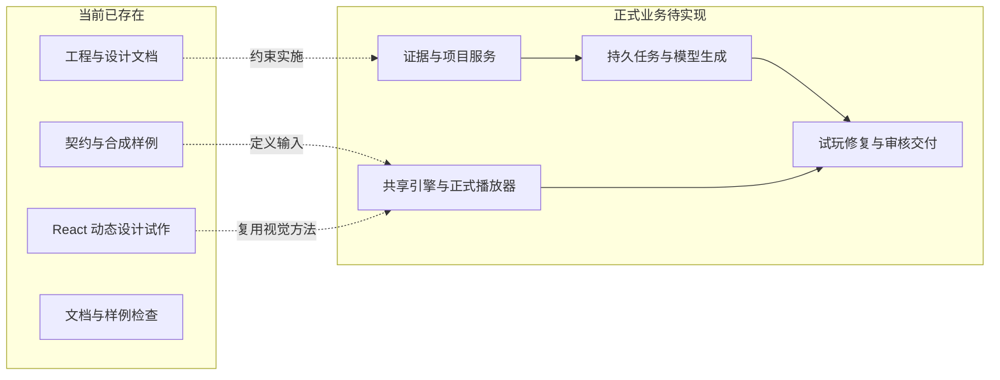

**图 2｜实现边界。** 当前试作可以保留为视觉参照，其局部排序判断不能直接升级为正式引擎。生产运行逻辑必须从 ExperienceSpec 和共享引擎重新贯通。

### 2.2 动态试作与正式前端的关系

试作源码在 [apps/design-preview](../apps/design-preview/README.md)，入口是 `src/main.tsx`。`App` 管理本地试作状态，`FieldDrawing` 绘制原创示意图，`Evidence` 演示来源抽屉，`SortTrial` 演示合成排序规则。构建脚本把 React、Motion 和样式打包成 [单文件预览](frontend/style-preview.html)。

它没有读取正式项目 API、运行生产 ExperienceSpec 或调用模型。后续可复用 Token、动效参数和成熟展示组件，不能复制它的演示数据作为产品数据。

实际记录：[初始化报告](quality/reports/2026-10-31-baseline.md)、[前端基线](quality/reports/2026-10-31-frontend.md)、[动态试作报告](quality/reports/2026-10-31-frontend-v2.md)。功能状态唯一真相为 [登记表](feature-registry.json)，目前九个业务功能均为 planned。

## 3. 九个业务模块及职责

| 模块 | 职责与输出 | 设计／规格 |
|---|---|---|
| F01 项目与工作台 | 身份、项目、简报、材料／预览／生成界面、进度重连 | [SDD](sdd/features/F01-project-workbench.md)／[SPEC](spec/features/F01-project-workbench.md) |
| F02 材料与证据 | 解析、原文定位、事实性质、来源快照、影响追踪 | [SDD](sdd/features/F02-sources-evidence.md)／[SPEC](spec/features/F02-sources-evidence.md) |
| F03 知识转译与生成 | 目标、机制理由、蓝图、真实模型生成 | [SDD](sdd/features/F03-blueprint-generation.md)／[SPEC](spec/features/F03-blueprint-generation.md) |
| F04 引擎与播放器 | 执行规格、三种机制、反馈、完成与重玩 | [SDD](sdd/features/F04-runtime-player.md)／[SPEC](spec/features/F04-runtime-player.md) |
| F05 检查、试玩与修复 | 结构／引用／状态检查、正常 UI 试玩、有限补丁 | [SDD](sdd/features/F05-validation-repair.md)／[SPEC](spec/features/F05-validation-repair.md) |
| F06 任务、恢复与费用 | 排队、租约、阶段结果、取消、事件、预算与费用 | [SDD](sdd/features/F06-runs-budget.md)／[SPEC](spec/features/F06-runs-budget.md) |
| F07 版本与局部修改 | 不可变候选、基准冲突、差异、审核失效、稳定指针 | [SDD](sdd/features/F07-versions-revisions.md)／[SPEC](spec/features/F07-versions-revisions.md) |
| F08 审核与交付 | 人工内容审核、固定分享、受控资源、草稿／正式导出 | [SDD](sdd/features/F08-review-delivery.md)／[SPEC](spec/features/F08-review-delivery.md) |
| F09 安全与运维 | 项目隔离、沙盒、部署、备份恢复、成本观测与评估 | [SDD](sdd/features/F09-operations-security.md)／[SPEC](spec/features/F09-operations-security.md) |

这些是同一仓库的模块，不代表要部署九个微服务。跨功能约束统一维护，避免每个模块再定义一套权限、版本或模型调用方式。

## 4. 一次真实创作应当怎样发生

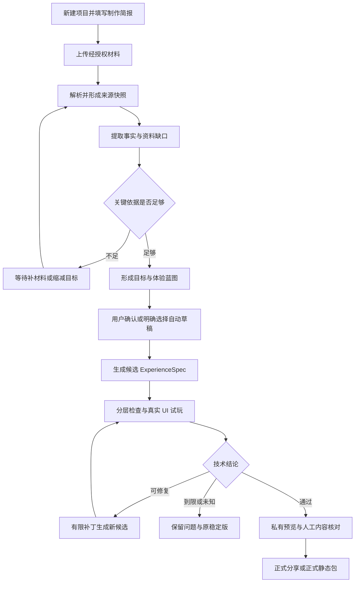

**图 3｜创作业务流程。** 蓝图确认与正式内容审核是不同动作；用户允许自动草稿，也不表示同意自动公开。

贯穿示例使用合成材料：“工具 X 用于观察；A、B 都先于 C；A 与 B 的顺序未规定。”体验应让玩家观察 X、获得线索、排列步骤、理解反馈并查看出处。ABC 和 BAC 都应通过，不能把材料没有规定的顺序补成唯一答案。

## 5. 核心方法：知识怎样变成玩法

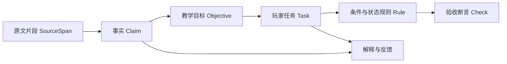

**图 4｜知识到行动的追踪链。** 任何必要任务都应解释清楚：为什么让玩家做这件事、依据是什么、怎样反馈、怎样检查。

| 材料关系 | 教学目标 | 玩家行为 | 判断与反馈 |
|---|---|---|---|
| 器物 X 的用途 | 辨认用途 | 点击热点查看线索，再选择 | 根据来源判断，解释用途 |
| 人物处境或条件 | 理解选择后果 | 选择分支 | 依据材料解释，保留传说／改编性质 |
| A、B 都先于 C | 理解前置关系 | 排列步骤并提交 | 接受 ABC/BAC；指出被违反的关系 |

内容性质分为 supported、legend、adaptation、unconfirmed。关键答案不能只依赖改编或待确认内容；模型辅助发现问题，人工审核判断材料是否真正支持陈述。来源存在、语义支持、外部历史真实性是三个不同层次。

## 6. 总体技术架构

### 6.1 采用什么结构

目标是**单仓库、模块化应用、可独立运行的 API／Worker／执行器**。前端与玩家引擎使用 TypeScript，资料和生成服务沿用原方案的 Python 路线。

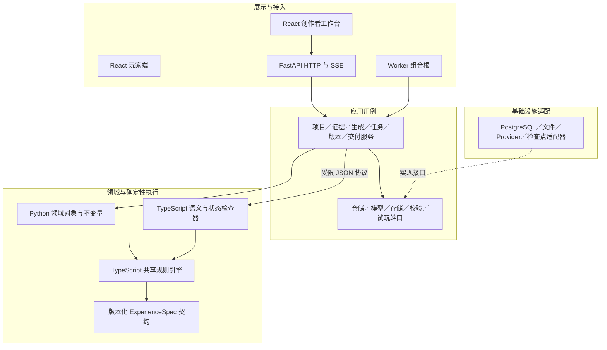

**图 5｜逻辑依赖图。** 实线主要表达调用／依赖，虚线表达端口实现。L5 隔离执行与交付是信任和部署边界，见第 13 节，不是领域对象还要继续向下依赖的一层。

### 6.2 各层必须守住什么

| 层 | 应当负责 | 不应承担 |
|---|---|---|
| L1 展示／接入 | 页面、输入、会话、HTTP/SSE、调用用例 | UI 直连数据库／模型；路由藏核心业务规则 |
| L2 应用 | 授权、事务、用例、端口和跨模块编排 | 把供应商 SDK、框架细节写进领域规则 |
| L3 领域／引擎 | 业务不变量、状态与执行语义 | 数据库、网络、系统时间、DOM |
| L4 基础设施 | 仓储、文件、解析、模型、检查点适配 | 绕过用例直接发布或跨项目访问 |
| L5 执行／交付 | 受限校验、浏览器试玩、资源投影与包 | 密钥、任意 URL／路径、宿主控制能力 |

API 与 Worker 可以经同一应用用例写数据库；靠事务、唯一约束、租约和 token 保护，而不是假设“只有一个进程写库”。Python 不重复实现玩家规则，播放器与校验器共用同一 TypeScript 引擎。

### 6.3 技术选择及当前状态

| 部分 | 当前设计 | 已验证范围 |
|---|---|---|
| 工作台／播放器 | React、TypeScript、固定组件 | 仅独立动态试作有实际构建 |
| 视觉／动效 | 中央 Token、CSS、Motion for React | Token 检查及试作 DOM 测试；真实观感未验收 |
| HTTP 服务 | FastAPI，按功能路由组织 | 设计，未建 API |
| 应用／数据 | Python 分层、PostgreSQL、迁移 | 设计，未建业务库 |
| 阶段编排 | Worker；LangGraph 可承载阶段与持久检查点 | 设计，未完成接入；不替代业务任务表 |
| 引擎／验证 | TS 纯函数引擎和状态搜索 | 契约已有，生产实现待建 |
| 浏览器试玩 | 隔离 Playwright Chromium | 设计，未建自动试玩链路 |
| 文件 | 本地持久卷与存储端口 | 设计，后续按需换对象存储 |
| 模型 | 可替换 Provider，服务端预算控制 | 具体供应商／模型仍待确定 |

混合语言会增加生成类型、进程协议和工具链成本。当前选择来自既有方案与 [ADR-0001](adr/0001-modular-layered-architecture.md)，不是因为动态试作已经用了 React 就推导出后端方案。若要改成全 TS，应比较成本并新增替代 ADR，不能边写边静默换架构。

## 7. ExperienceSpec 与播放器设计

### 7.1 结构化规格是什么

ExperienceSpec 是体验内容与规则的声明，不是待执行的自由程序。

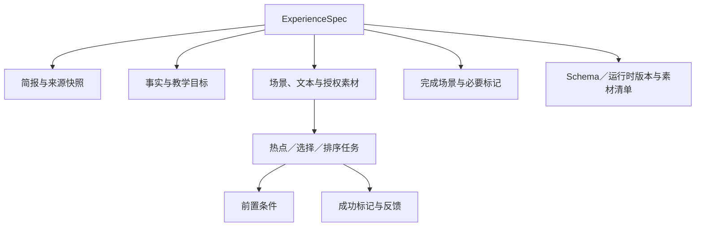

**图 6｜规格结构。** 顶层字段、判别联合、数量和枚举以 [机器 Schema](../packages/contracts/experience-spec.schema.json) 为准；执行及跨引用规则以 [DSL 规格](spec/experience-spec.md) 为准。

初始限制：4—6 场景、1—6 必要任务、最多 12 个布尔标记、每个排序 2—6 元素。条件仅 all／any／not／flag_equals；标记初始 false，成功时只能设 true。每项任务有独占完成标记，不能由其他任务的效果代为完成。

### 7.2 一次玩家动作怎样执行

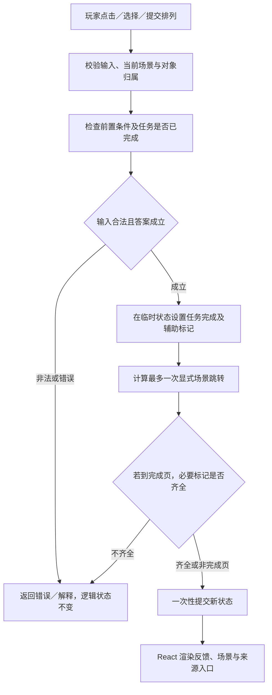

**图 7｜共享引擎的原子执行。** React 动效表现结果，不能在动画结束回调中判胜、解锁或发起模型调用。逻辑状态为 scene_id＋flags；提示展开、尝试展示、来源卡开关不参与解锁。

状态检查不只看场景连线：从初态枚举可达状态，验证有完成路径、所有可达非终态仍有完成后续、完成态都满足必要任务。超过搜索时间／数量上限返回 inconclusive，不能写 passed 或无解。

## 8. 生成、试玩与修复架构

### 8.1 模型承担什么职责

| 阶段职责 | 输入 | 输出 | 权限边界 |
|---|---|---|---|
| 内容分析 | 源快照与简报 | 事实候选、关系、缺口 | 不补造历史事实，不联网补依据 |
| 体验设计 | 事实与目标、机制目录 | 蓝图、机制选择理由 | 只能选择运行时支持的机制 |
| 规格生成 | 冻结蓝图与契约 | ExperienceSpec 候选 | 无脚本、终端或直接发布工具 |
| 修复诊断 | 报告、基准哈希、依赖关系 | 受限补丁与影响说明 | 不修改测试器、不删除必要目标、不批准内容 |

这些职责可以串行复用同一模型，无需为了“Agent 架构”先建设多 Agent 平台。阶段由确定性流程控制，工具服务端二次授权。

### 8.2 检查与修复闭环

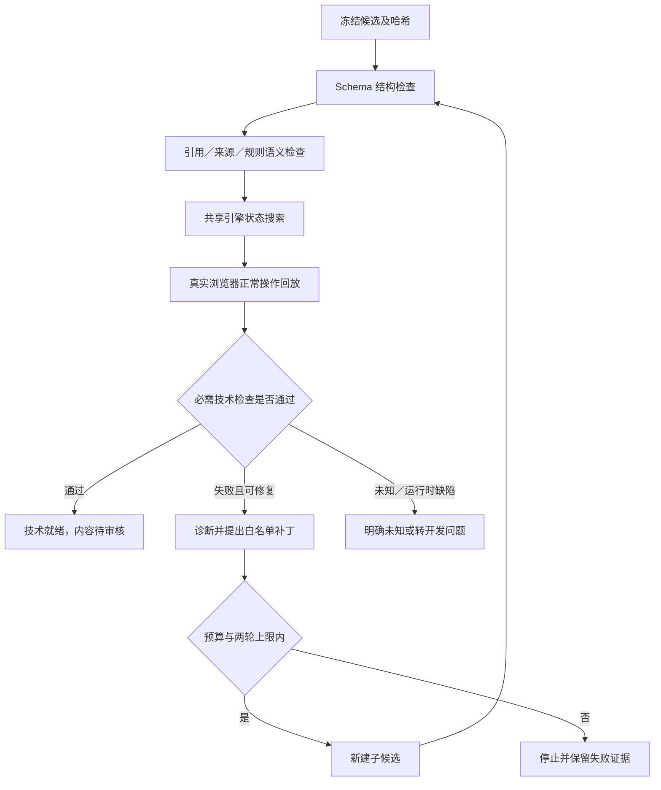

**图 8｜技术闭环。** 修复后重跑全局结构／引用／状态检查，以及受影响浏览器路径和至少一条完整完成路径。不得通过直接注入完成状态冒充正常 UI 试玩。

技术通过证明列明范围内可以运行；内容审核判断材料支持；真实用户试用判断可读性与可理解性。三者分别留证据。

## 9. 持久任务、恢复、取消与预算

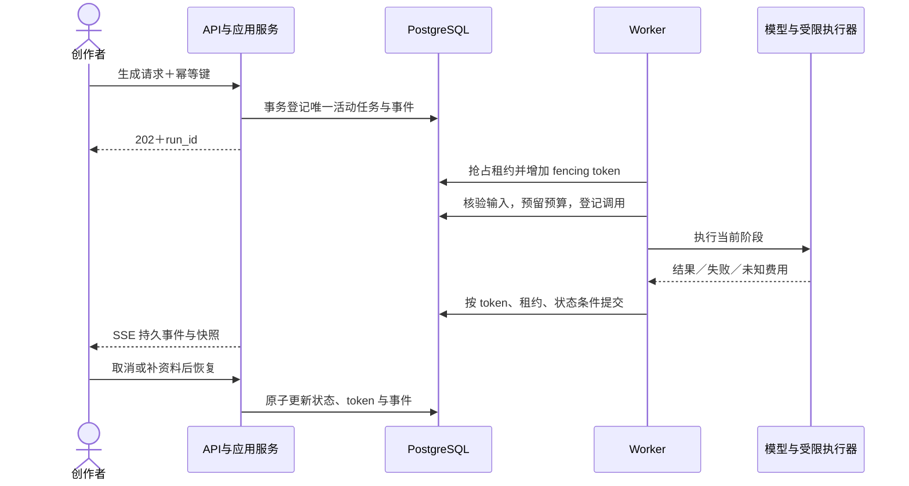

**图 9｜异步运行。** 外部调用不在数据库事务中等待；阶段结果登记后才能复用。旧 Worker 的 token 失效时，迟到提交被拒绝。

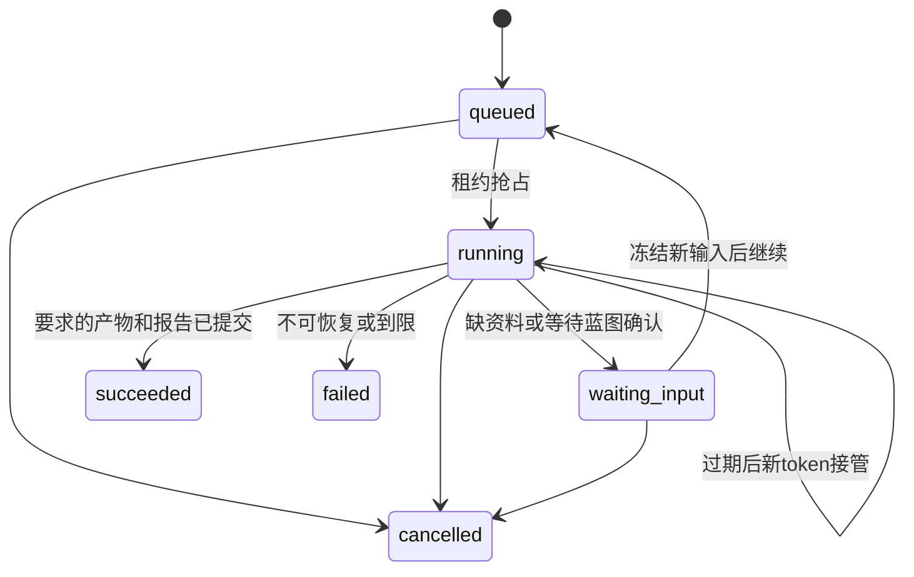

**图 10｜任务生命周期。** 阶段名称与生命周期分开。waiting_input 释放 Worker 租约，但仍占项目活动任务名额。succeeded 不等于内容已批准或已经发布。

初始预算：每项目一个活动生成／修订任务；最多两轮修复、12 次外部模型调用（含重试）；总活跃执行时间初值 600 秒。费用分 actual／estimated／unknown，未知不记零。外部结果未登记的故障窗口仍可能重复计费，不承诺外部调用全局恰好一次。

取消与完成争用同一任务锁：谁先提交决定结果；取消后不启动新调用、不提交迟到版本，已发生费用仍记录。详细约束见 [状态机](spec/state-machines.md) 和 [API](spec/api.md)。

## 10. 数据与版本设计

### 10.1 核心数据关系

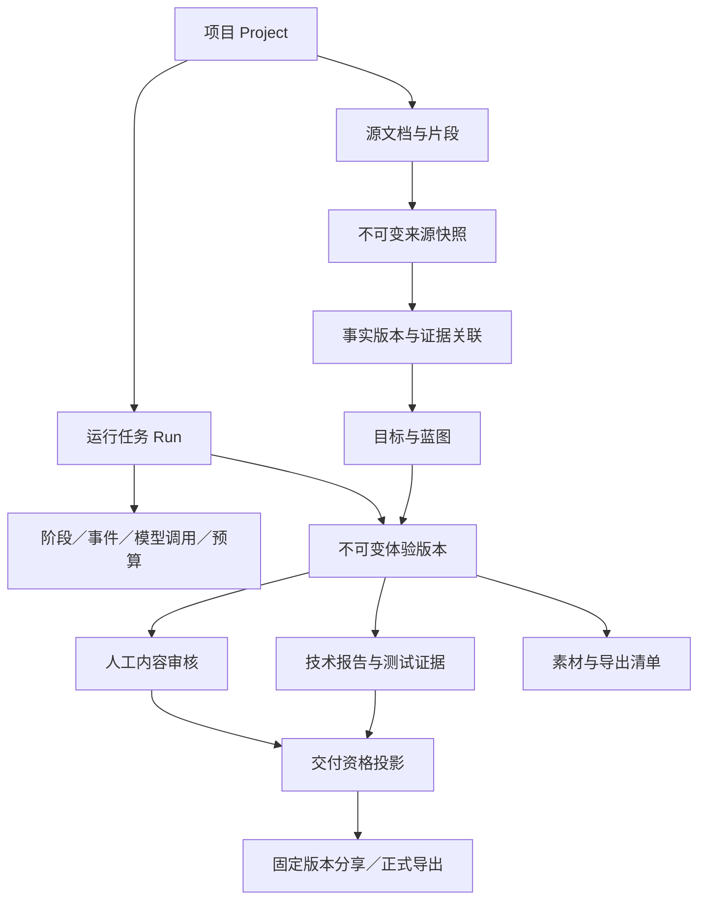

**图 11｜主要领域关系。** 这是目标关系图，并非已经建好的数据库。完整表与约束见 [数据模型](spec/data-model.md)。

| 数据组 | 表／记录 | 关键规则 |
|---|---|---|
| 项目与输入 | projects、source_documents、source_spans | 每资源同项目授权；页段及 Unicode 码点定位稳定 |
| 证据与蓝图 | claims、claim_evidence、source_snapshots、blueprints | 冻结具体事实 revision 与材料哈希 |
| 运行与费用 | runs、run_steps、run_events、model_calls、budget_reservations | 活动任务唯一，阶段幂等，预算原子预留 |
| 版本与质量 | experience_versions、validation_reports、content_reviews、review_items | 内容不可变，报告／审核追加并绑定哈希 |
| 交付与文件 | artifacts、shares、exports | 固定版本、授权投影、令牌哈希与撤销 |
| 请求幂等 | idempotency_requests | 同键同摘要复用，换摘要返回冲突 |

同项目关系必须由事务／复合外键等保护，不能仅先查一次权限再裸写 ID。文件内容按哈希存储；先写文件、验哈希、原子发布，再提交引用，孤儿文件延迟清理。

### 10.2 修改与稳定版如何共存

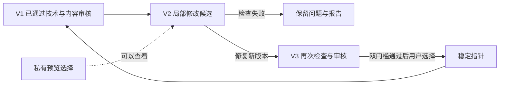

**图 12｜不可变版本与指针。** 修改和修复均新建候选。失败不会覆盖稳定版；回到旧版是移动指针，不删除历史。

项目同时区分：最新候选、允许修改的 revision_head、当前私有预览 selected、正式合格 stable。修订必须携 base_version_id；旧基准或活动任务冲突返回 409，不静默覆盖。涉及事实、依据、叙述或规则的语义修改使审核失效；纯样式复用审核也必须基于明确语义哈希策略。

## 11. 页面与交互设计

### 11.1 首版页面只围绕三处组织

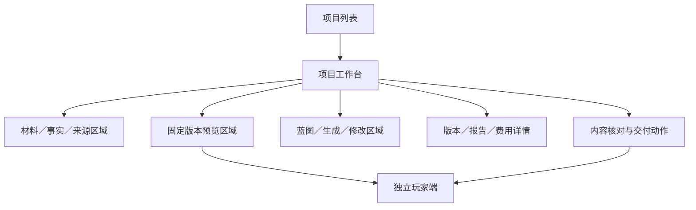

**图 13｜信息架构。** 材料、生成、版本和测试主要作为工作台分区或抽屉，不为九模块各建一个复杂后台。

```text
┌──────────────── 项目名称／当前版本／审核状态 ────────────────┐
│ 材料与依据           │ 体验预览               │ 生成与修改   │
│ 文件与解析状态       │ 手机／桌面尺寸         │ 制作简报     │
│ 事实与资料缺口       │ 场景与三类任务         │ 蓝图与理由   │
│ 原文定位与内容性质   │ 提示、解释、来源       │ 进度／取消   │
│                      │ 重玩与复盘             │ 修改指令     │
├───────────────────────────────────────────────────────────┤
│ 按需展开：版本差异／测试报告／失败步骤／截图／费用／审核     │
└───────────────────────────────────────────────────────────┘
```

桌面按宽度展开三栏或两栏；小屏使用资料／预览／生成标签切换。来源或详情抽屉需焦点管理、键盘关闭与返回。网络失败和版本冲突保留用户修改文字。

### 11.2 玩家端的基本体验循环

进入目标说明 → 观察获取线索 → 选择或排列 → 即时解释 → 下一场景 → 复盘与出处。答错允许重试，不能把读提示或展开出处当作完成任务。

排序同时支持拖拽与上移／下移；关键操作有触控和键盘路径。来源入口贯穿体验。完成页核验必要任务；重玩只重置玩家会话，不改创作者版本。

### 11.3 UI 与动效怎样服务业务

保留海盐蓝绿、奶油白、墨色、少量暖橙。入口／玩家端可以用图版、纸页与章节入场；工作台降低动效密度，优先信息清晰。

| 动效 | 用途 | 必须守住 |
|---|---|---|
| 短标题入场 | 建立章节与阅读起点 | 完整可访问文本，减弱时即时可见 |
| 场景／抽屉转场 | 解释位置变化 | 焦点正确，退出内容不可继续操作 |
| 线索与正误反馈 | 连接动作和知识结果 | 结果立即提交，不等动画结束 |
| 排序位置过渡 | 让位置变化可理解 | 键盘与按钮可用，关闭动画不影响答案 |

当前试作的器物图、事实与规则是合成演示，不把图中的器物包装成经认证文化档案。完整视觉参数见 [前端规范](frontend/README.md)。

## 12. API、端口与公共契约

| 边界 | 负责交换什么 | 约束 |
|---|---|---|
| 工作台 ↔ API | 项目、材料、任务、版本、审核、交付 | HTTP DTO 由未来 FastAPI OpenAPI 派生客户端 |
| API → Worker | 持久任务引用与冻结输入 | 不把浏览器连接当任务存活条件 |
| Worker → Provider | 受控提示、证据、结构化输出 | 仅服务端凭据；每次调用受预算约束 |
| Python → TS 检查器 | 候选 ID／哈希、有限 JSON 输入 | 不传自由脚本、shell 或任意路径 |
| Worker → 试玩执行器 | 临时预览句柄、正常动作路径 | 固定资源范围，浏览器不持有密钥 |
| 播放器 → 引擎 | 玩家动作和只读规格／状态 | 纯函数确定性输出，不直接写完成标记 |

代表接口：创建项目、上传来源、提交 run、读取 run／SSE、取消／恢复、提交 revision、读取 version／reports、人工 reviews、exports／shares。完整路径与错误约定在 [API 规格](spec/api.md)，本文不另维护第二份完整接口表。

ExperienceSpec 的结构权威是 JSON Schema；语义约束是 DSL SPEC；HTTP DTO 是未来 OpenAPI。三者职责不同，不能手写两个语言版本的公共 DSL 后靠人工同步。

## 13. 部署与安全边界

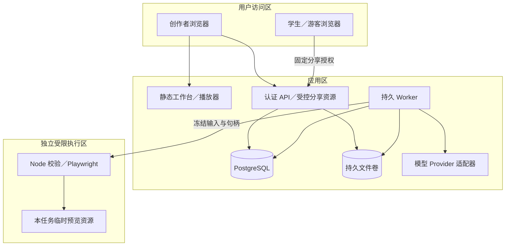

**图 14｜目标部署与信任边界。** 首版可用 Compose 组织这些进程，不提前建设 Kubernetes、独立向量数据库、Redis 队列或九套业务微服务。图中数据库写入均经过应用服务和约束。

关键边界：每次子资源访问核验项目；模型无终端／任意 URL／文件路径权限；试玩环境无模型密钥、宿主目录和容器控制套接字；预览来源隔离，运行资源受限。

正式分享和正式导出同时要求：技术 passed、内容 approved、报告／审核哈希匹配、素材与引文授权有效。草稿导出仅所有者显式选择，并带草稿标记。

分享令牌绑定固定版本，页面、规格、图片、出处投影全部经过同一授权。撤销阻断后续在线访问；已下载包、已保存副本无法远程撤回。导出只含必要规格、授权素材和允许公开的引文，不含私有全文、密钥、内部提示或运行日志。

详细边界：[安全规格](spec/security.md)。备份必须同时包括数据库、文件和运行时清单，并实际恢复验证，不能只有备份命令记录。

## 14. 开发顺序：先贯通功能，再继续扩充外观

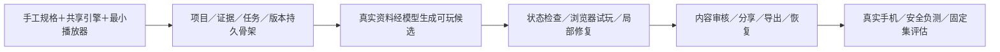

**图 15｜实施顺序。** 当前设计小样是辅助产物，不算图中任一业务阶段已经完成。下一项核心任务仍是 F04-T01。

| 阶段 | 必须看到的可运行成果 | 不满足时怎样处理 |
|---|---|---|
| M0 | 同一完整手工 ExperienceSpec 驱动引擎与播放器；正反操作和两种合法排序正确 | 修正规则，不继续扩展主题和装饰 |
| M1 | 项目隔离、来源快照、不可变版本、持久任务能保存和恢复 | 先补数据和失败路径 |
| M2 | 新授权材料经真实模型生成新体验，有调用与费用记录 | 冻结辅助 UI，不用预置故事替代 |
| M3 | 故障被检测，正常 UI 可完成，补丁受限，失败保留稳定版 | 缩减分支／状态空间，不用模型口头评审代替 |
| M4 | 人工核对、双门槛、受保护分享、离线包、取消／恢复竞争正确 | 分享不安全则暂不对外开放 |
| M5 | 真实手机、安全、备份恢复、正常集和故障集评估有证据 | 未验证项保留，不能标 released |

原方案三人六周只是排期假设，当前未确认团队和资源，不作为承诺。具体任务与依赖见 [实施路线](roadmap.md)。

## 15. 验收怎样证明方向正确

| 要判断什么 | 最低证据 | 不能用什么替代 |
|---|---|---|
| 知识参与玩法 | 目标—事实—任务—反馈有追踪；删除唯一依据会影响对应任务 | 只换背景介绍和知识卡 |
| 是真实生成 | 未预置材料、具体模型调用、输出与版本记录 | 固定演示或模拟调用 |
| 技术可完成 | 完整状态结论和正常 UI 试玩 | 场景图连通或 Schema 通过 |
| 内容可交付 | 关键陈述、答案与解释有依据并经人工审核 | 模型自评“文化准确” |
| 修改可靠 | 新候选、影响差异、复测、冲突和稳定版保护 | 原地覆盖 JSON |
| 工程可恢复 | 重启、重复投递、旧 token、取消竞争与恢复演练 | 文档写了“支持恢复” |
| 有用户价值 | 目标创作者真实试用与制作流程记录 | 页面漂亮或成功通关 |

质量分层：文档／Schema → 引擎独立预期 → 真实数据库竞争 → 浏览器 → 真实模型 → 人工内容与实际手机。每层说明范围，未知、失败、未跑分别保存。

现有设计试作的 5 项 DOM 测试只覆盖局部交互；不能证明全产品完成、真实浏览器动画流畅或已经改善学习效果。

## 16. ADR、SDD、SPEC 和本文的关系

| 文档 | 回答的问题 | 使用入口 |
|---|---|---|
| CLAUDE.md | 开发必须守哪些边界，怎样认定完成 | [核心约束](../CLAUDE.md) |
| ADR | 为什么选这条路线，替代与代价是什么 | [决策总目录](adr/README.md) |
| SDD | 如何分层实现，数据与控制怎样流动 | [设计总目录](sdd/README.md) |
| SPEC | 外部行为、数据、权限、错误、验收必须怎样表现 | [规格总目录](spec/README.md) |
| 功能登记表 | 当前需求／任务／验收 ID 和真实实施状态 | [登记表](feature-registry.json) |
| 本文 | 集中阅读并检查整个方向是否一致 | 当前文件 |

本文是总览与方向审阅入口，整合现行设计，不取代细节事实源。重要取舍变化先更新 ADR，行为变化更新 SPEC，再同步 SDD 与本文；历史检查报告保留，不把旧失败抹掉。

## 17. 待确定事项与下一步边界

目前尚未确定：具体模型、身份提供方、生产环境、真实材料与授权、内容审核人、团队、数据保留期限，以及价值／成本的实测基线。这些事项不能通过 UI 或架构图自动解决。

下一步开发应回到正式引擎与手工规格的第一条纵向链路：加载契约 → initialState → evaluateCondition → applyAction → 三类组件 → 来源／复盘 → 状态验证。已有视觉成果作为参考复用，不继续以新增页面、主题或动效数量代替业务进度。

审阅时优先看第 1、2、4、6、14、15 节：定位是否一致、当前事实是否清楚、主链路是否完整、技术成本是否合理、开发顺序是否正确、验收能否证明产品价值。

---

**本轮核对范围：**读取原始完整项目方案的产品／MVP／方法章节，核对当前产品、ADR、SDD、SPEC、状态、试作源码入口及已有检查报告。本文中的正式系统流程、数据库、API、Worker 和发布图均为目标设计；本轮只整理和校对文档，未新增业务或视觉功能。Mermaid 是可编辑图源码，支持 Mermaid 的 Markdown 阅读器可直接渲染。

**文档校验：**本轮文档检查通过；15 张图均经 Mermaid 解析器语法验证。没有进行图表渲染布局验收，也没有据此宣称业务测试通过。
