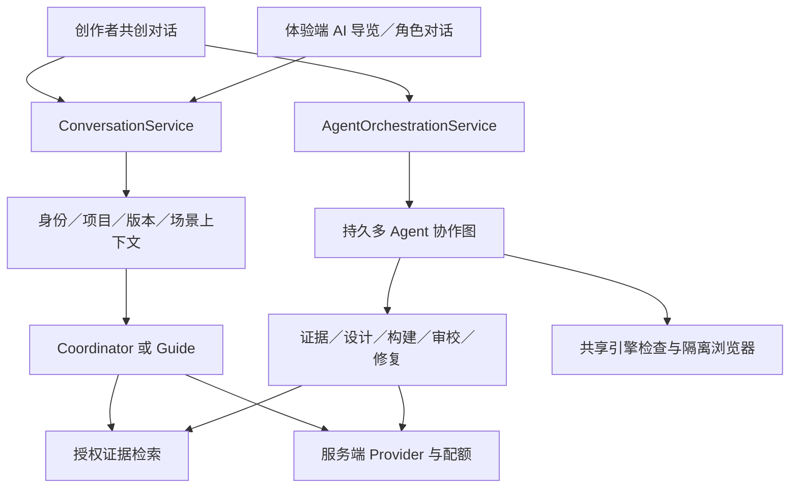
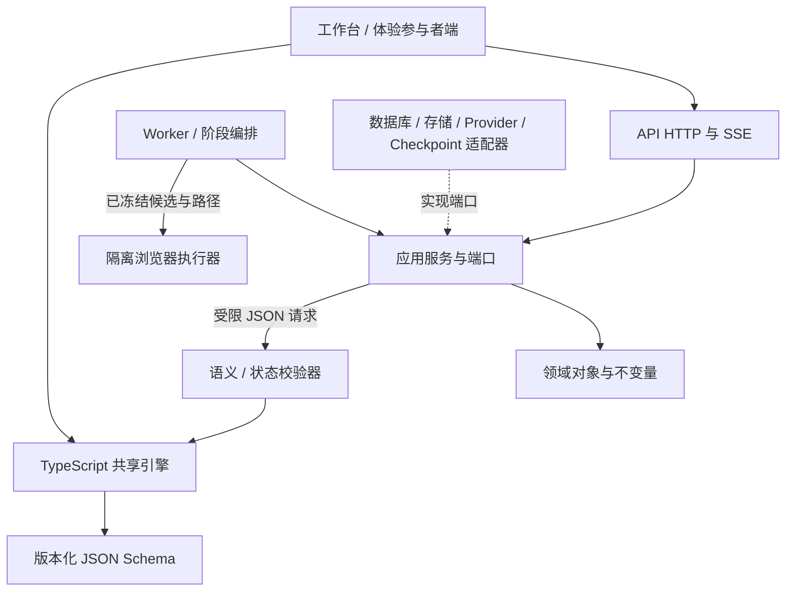
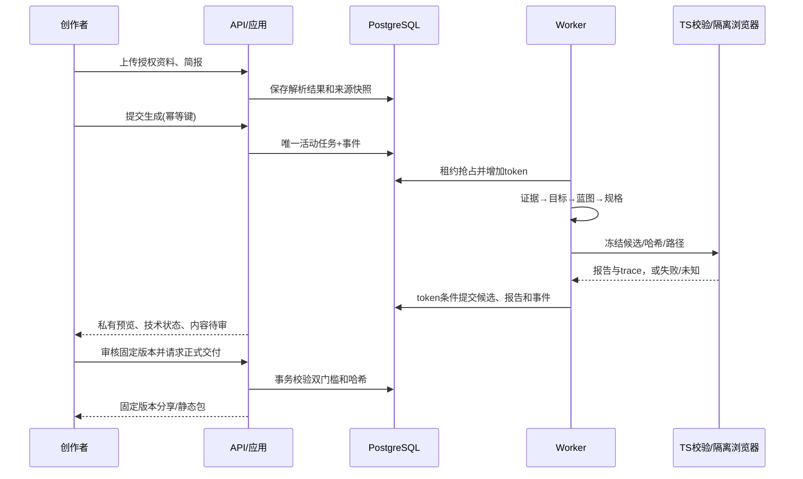

# 叙境总架构

> 当前总览：[V2 多 Agent 与 AI 对话架构](../architecture-and-design-v2.md)，受 [ADR-0010](../adr/0010-multi-agent-and-conversation.md) 约束。以下通用分层保留；生成侧新增 F10 专业 Agent 图，在线侧新增 F11 ConversationService 与 Guide。

在线对话走 API 异步用例，长生成走 Worker；二者复用基础设施端口而不互相排队。Agent 上下文/工具/交接/费用按子任务隔离；Guide 只读固定发布版本的对外证据，不写项目或完成状态。

> 设计基线 v1.0，2026-10-31；目标目录不表示源码已经存在。决策见 [ADR-0001](../adr/0001-modular-layered-architecture.md)。

## 逻辑分层

应用服务定义 repository、unit-of-work、blob-store、model-provider、validator、playtest、checkpoint 端口。基础设施实现端口；组合根注入。LangGraph 节点调用用例，不持有绕过规则的 SQL 或发布工具。

## 进程与部署

Web 静态服务提供工作台和体验运行端；API 处理认证、授权、HTTP、SSE；Worker 抢占 PostgreSQL 任务并执行阶段；独立执行器运行 Node 校验与 Playwright。PostgreSQL 保存业务与运行记录，持久卷保存哈希文件。首版无需 Redis、向量库、Kubernetes 或多个自治业务服务。

试玩环境使用独立来源、临时资源清单和严格出口白名单；模型密钥仅进入服务端 Provider 适配器（生成 Worker 与在线对话用例），不进入浏览器或包。工作台 API 与分享资源路由具有不同授权策略；公开部署前必须落地生产身份适配器。

## 模块与数据所有权

| 模块 | 写入所有者（逻辑） | 只读消费者 |
|---|---|---|
| 项目/简报 | ProjectService | 工作台、生成、权限 |
| 原文/片段/快照/事实 | EvidenceService | 设计、验证、审核 |
| 蓝图 | DesignService | 生成、工作台 |
| 任务/阶段/预算/事件 | RunService | Worker、SSE、费用展示 |
| 版本/补丁/指针 | VersionService | 预览、验证、交付 |
| 报告 | ValidationService | RunService、交付门禁 |
| 审核/分享/导出 | DeliveryService | 工作台、受保护资源端点 |

所有写入经过应用服务的事务和数据库约束；API/Worker 可并发使用同一逻辑入口。文件先写临时键、验哈希、原子发布，再提交数据库引用；事务失败留下的孤儿由延迟清理回收，不删除仍被版本引用的文件。

## 一条完整主链路

依据不足进入 waiting_input；格式/规则问题进入至多两轮修复；引擎缺陷转开发问题，不让模型修改运行时。

## 事务与一致性边界

生成请求：同事务完成幂等登记、项目活动任务唯一约束和初始事件。阶段提交：核验 run/token/lease/state，写阶段结果、候选引用、事件。候选发布：先冻结内容，报告绑定 spec/runtime/source/asset 哈希，再根据质量推进状态；正式分享在事务内重新检查资格。

外部模型、文件写入和浏览器不在数据库事务中等待。阶段键和调用记录减少重复；无法排除外部返回但本地未登记的未知窗口。数据库连接失败不返回空列表或成功。

## 横切约束

认证与项目授权贯穿每个资源端点；日志使用 request_id/project_id/run_id/version_id，不默认记录原文。共享引擎不读网络、时钟或全局状态；体验运行端来源卡开关不影响解锁。报告的 passed 只覆盖列明范围。更多见 [五层设计](layers/README.md)、[状态机](../spec/state-machines.md)、[数据](../spec/data-model.md) 和 [安全](../spec/security.md)。

