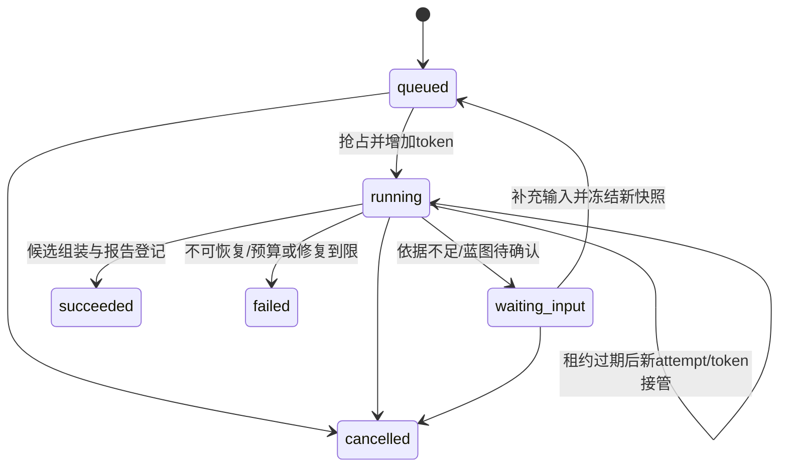

# 状态机与竞争语义

状态独立建模：任务成功不表示内容批准，当前预览不表示稳定发布。所有状态变化由应用用例记录持久事件；数据库时间用于租约，UTC 存储。

## 任务生命周期

终态 succeeded/failed/cancelled 不倒退。succeeded 表示本次要求的候选产物及检查记录已提交，不表示可正式发布；技术 failed/inconclusive 的候选仍可保留，但对应自动生成任务到限应 failed。生成目标仅为私有草稿的任务可成功并保留内容 pending。

waiting_input 释放 Worker 租约但仍占项目活动任务名额；可继续或取消。恢复权限核验、新输入快照、总调用/费用/修复计数不得重置。Worker 接管只复用当前输入哈希相同且已提交的阶段；不同输入重算依赖阶段。

阶段与生命周期分开：parse/extract/plan/generate/validate/playtest/repair/assemble；跳转由阶段输入/输出契约决定，不靠展示文案。

## 租约、取消与提交

默认租约 30 秒，心跳每 10 秒，均为部署可调初值。抢占使用数据库事务/行锁并增加 token。每次提交带 run_id、token、step_key、input_hash；SQL 条件同时要求 running、token 匹配、lease_expires_at > DB now。

取消用同一行锁把非终态置 cancelled、token 增加、租约清空并追加事件。提交先成功则取消返回已完成快照；取消先成功则迟到提交失败。外部已发生调用仍结算，取消之后不得开始新调用。故障注入要覆盖两个顺序。

## 技术与内容

| 轴 | 状态 | 转移规则 |
|---|---|---|
| technical_status | not_run/passed/failed/inconclusive | 当前版本所要求检查全部通过才 passed；旧报告哈希不匹配为 not_run |
| content_status | pending/approved/needs_changes | 审核覆盖全部关键陈述与必要任务且有人工记录才 approved |
| parse_status | pending/parsing/ready/failed | 空白扫描 PDF 直接 failed，不生成 ready 空文本 |
| cost_status | actual/estimated/unknown | 实际账单/供应商 usage 才 actual；未知不能推断为零 |

质量是绑定具体内容的投影，可由追加记录重算，不修改版本 JSON。通过新检查可以从 failed 变 passed，但旧失败报告保留；修改内容必须产生新版本，不在同一版本上改答案。

## 项目指针

- latest_candidate_version_id：最后提交的候选，即使失败也可存在。
- revision_head_id：允许作为下一次修改基准的候选头；首次导入手工版本后建立。活动修改槽由 run_id 预留，成功/失败创建新候选后推进到新候选；没有产物的失败释放槽并保留旧 head。
- selected_version_id：创作者当前私有预览选择，不自动影响基准和稳定版。
- stable_version_id：创作者选定、技术 passed 且内容 approved 的版本；正式发布仍检查授权是否撤销。

这些指针不能互相冒充。两个修改同 base：第一个事务预留活动任务，第二个 409 ACTIVE_RUN；第一个结束后旧 base 为 409 VERSION_CONFLICT。无自动语义合并。

## 审核、分享与导出

审核逐项追加；语义内容哈希变化 pending；纯样式可通过显式 review_reuse 关联同语义旧记录。分享 active→revoked/expired，不自动复活。正式导出 queued→building→ready/failed，执行前后都核对资格；ready 的下载仍验证所有者与当前授权。草稿包永久标明 draft，但下载后的标记无法技术强制禁止移除。

## V2 Agent 子任务与对话状态

AgentTask：pending → ready → running → succeeded/failed/cancelled；依赖未满足不 ready，汇合必须收齐要求的审校和工具结果。恢复保留原产物/失败，旧 token 拒绝提交。全局取消取消未启动任务并阻断新调用，费用仍记录。

ConversationTurn：queued → streaming → succeeded/failed/cancelled。partial 文本可显示但不能当成功答案。取消与完成事务竞争，已经完成不倒退；重试/重连不复用同键生成第二条完整回答。固定版本失效/分享撤销后授权失效，不能继续输出或读取受保护回复。

Session 的权限、事实锚点和固定版本独立于消息摘要。结构化任务状态与自然语言会话状态分开，聊天不直接产生 completion_flag。生成全局预算与对话预算分开计量、统一限制总费用。

